# Money Manager Cloud

An AI-powered, multi-tenant personal finance application hosted on **Google Cloud Run** and backed by **Google Cloud Storage (GCS)**. It automatically ingests bank alert emails from Gmail, parses financial details using **Google Gemini 3.8 Flash**, and visualizes spending trends, cash flows, category distributions, and investment portfolios in an **Apple Liquid Glass (Cupertino)** dashboard.

Designed from the ground up to **scale to zero**, keeping your monthly Google Cloud hosting cost at **$0.00**.

---

## Architecture Overview

```mermaid
flowchart TD
    User([User Browser]) <-->|HTTPS| CloudRun[Google Cloud Run\nStreamlit Container\nasia-south1]
    CloudRun <-->|Cloud Storage FUSE /data| GCS[(Private GCS Bucket\nilaya-bharathi-murugan-money-data)]
    
    subgraph MultiTenantData [Multi-Tenant Data Layer]
        GCS --- AuthDB[(auth.db\nUsers & Salts)]
        GCS --- User1DB[(users/user_1.db\nIsolated DB)]
        GCS --- User2DB[(users/user_2.db\nIsolated DB)]
    end
    
    CloudRun <-->|IMAP SSL or OAuth 2.0| Gmail[Gmail Server\nBank Alert Emails]
    CloudRun <-->|Interactions API| Gemini[Google Gemini 3.8 Flash\nAI Extraction Engine]
```



### Key Architectural Highlights
1. **Multi-Tenant Physical Isolation**: Every user receives a private SQLite database (`users/user_{id}.db`). There is zero chance of cross-user data leakage.
2. **Scale to Zero ($0 / Month)**: When not in use, Cloud Run instances scale down to 0. You only pay for the exact seconds you interact with the dashboard.
3. **Stateless Compute + Persistent Storage**: SQLite databases persist on a private GCS bucket mounted via Cloud Storage FUSE.
4. **Resilient High-Volume Sync**: Thread-safe worker pools process 200+ bank alert emails concurrently with exponential backoff and rate-limit handling.

---

## Technology Stack

| Component | Technology | Description |
| :--- | :--- | :--- |
| **Frontend UI** | Streamlit 1.40+ | Interactive web interface styled with custom Apple Cupertino CSS |
| **Data Visualizations** | Plotly Express & Graph Objects | Category Donut Wheels, Asset Allocation Wheels, Spending Timelines |
| **Data Engine** | Pandas & SQLite3 | Multi-tenant local SQLite with in-memory journaling (`PRAGMA journal_mode=MEMORY`) |
| **Cloud Hosting** | Google Cloud Run (`asia-south1`) | Serverless container execution with auto-scaling (0 to 1 instance) |
| **Cloud Storage** | Google Cloud Storage (GCS) | Private cloud bucket mounted via Cloud Run FUSE Volume (`/data`) |
| **AI Parsing** | Google Gemini 3.8 Flash | `google-genai` SDK using the Interactions API (`client.interactions.create`) |
| **Fallback AI** | Groq API (`llama-3.3-70b-versatile`) | Ultra-fast secondary AI parsing engine |
| **Email Ingestion** | Python `imaplib` & `googleapiclient` | Concurrent email body extraction with MIME traversal |
| **CI/CD** | GitHub Actions | Automated build and deployment to Cloud Run on push to `main` |
| **Containerization** | Docker (Python 3.11-slim) | Lightweight container optimized for fast startup |

---

## Email Processing & Concurrency Performance

Money Manager Cloud is engineered to handle large mailboxes and high-volume email syncs reliably:

* **Capacity**: Effortlessly parses **200+ emails per batch**.
* **Parallel Execution**: Uses a `ThreadPoolExecutor(max_workers=6)` pool to fetch and process emails concurrently.
* **Thread-Isolated Sessions**: Uses `threading.local()` to maintain separate IMAP and OAuth client sessions across threads, preventing socket collisions.
* **Tombstone Deduplication**: Once an email is parsed (or recognized as a non-transaction alert), its unique `email_id` is recorded in `transactions` or `deleted_emails`. Subsequent syncs skip these emails instantly.
* **Single Atomic Commit**: Transactions are inserted in bulk via `insert_transactions_batch()` in a single database transaction, preventing SQLite write contention on GCS FUSE.
* **Rate-Limit Resilience**: Includes exponential backoff retries (HTTP 429) to handle API bursts gracefully without dropped alerts.

---

## Cost Optimization & Zero-Cost Strategy

This application is configured to leverage Google Cloud's **Always Free Tier**, resulting in **$0.00 / month** under normal personal usage (e.g., 200 transactions/month and daily dashboard visits):

| GCP Service | Free Tier Allowance | Application Usage | Estimated Monthly Cost |
| :--- | :--- | :--- | :--- |
| **Cloud Run** | 2,000,000 requests/mo<br>360,000 vCPU-seconds<br>180,000 GiB-seconds | ~300 requests/mo<br>~15,000 vCPU-seconds<br>~30,000 GiB-seconds | **$0.00** |
| **Cloud Storage** | 5 GB Standard Storage/mo | < 20 MB total database size | **$0.00** |
| **Network Egress** | 100 GB free to worldwide | < 50 MB total egress | **$0.00** |
| **Gemini API** | Billing Account (Pay-as-you-go) | ~200 input/output calls/mo | **< ₹5.00 ($0.05)** |
| **Total** | | | **~₹0.00 to ₹5.00** |

### Key Flags Enabling $0 Cost:
* `--min-instances 0`: Container terminates when idle. No CPU or RAM is billed while closed.
* `--max-instances 1`: Limits parallel instances to prevent runaway compute costs.
* `PRAGMA journal_mode=MEMORY`: Reduces GCS storage write calls by caching SQLite journals in memory.

---

## Security Architecture

```
                                  [ Private GCS Bucket ]
                                            │
               ┌────────────────────────────┴───────────────────────────┐
               ▼                                                        ▼
         [ auth.db ]                                            [ users/user_N.db ]
  • Usernames                                             • Bank Alert Sender Configuration
  • 16-byte Cryptographic Salt                            • Gmail App Password / OAuth Token
  • 100,000-iteration PBKDF2-SHA256 Hash                  • Gemini / Groq API Keys
  (NO plaintext passwords stored)                         • Transaction History & Portfolio Values
```

1. **Password Protection**:
   * Passwords are never stored in plaintext.
   * Uses **PBKDF2-HMAC-SHA256** with **100,000 rounds** and unique 16-byte random salts.
   * Verifications use constant-time comparisons (`hmac.compare_digest`) to protect against timing attacks.
2. **Credential & API Key Isolation**:
   * Bank email addresses, Gmail app passwords, and Gemini/Groq API keys are stored only inside the user's private database (`user_{id}.db`).
   * No keys or credentials are hardcoded or shared across tenants.
3. **100% Parameterized Queries**:
   * All database calls use SQL parameter binding (`?`), eliminating SQL injection vulnerabilities.
4. **Masked UI Fields**:
   * Passwords, Google App Passwords, and API keys use `type="password"` in Streamlit to prevent screen-capture or DOM leaks.
5. **Least-Privilege Cloud IAM**:
   * The Cloud Run service account is restricted to read/write access on the designated bucket only.

---

## Project Structure

```
money_manager_cloud/
├── .github/
│   └── workflows/
│       └── deploy.yml            # CI/CD deployment pipeline to Cloud Run
├── app/
│   ├── ai_parser.py              # Gemini 3.8 Flash / Groq LLM email parser
│   ├── categories.py            # Financial classification rules & categories
│   ├── dashboard.py             # Streamlit web UI (Apple Liquid Glass design)
│   ├── database.py              # Multi-tenant SQLite database management
│   ├── email_reader.py          # Thread-safe Gmail IMAP / OAuth email reader
│   ├── sync.py                  # Concurrent multi-worker email sync pipeline
│   └── favicon.png              # Custom Apple Glass browser tab icon
├── Dockerfile                   # Python 3.11-slim container configuration
├── requirements.txt             # Application Python dependencies
└── README.md                    # Project documentation
```

---

## Setup & Deployment Guide

### Step 1: Create GitHub Repository & Clone

1. Create a new repository on GitHub (e.g., `money_manager_cloud`).
2. Clone the repository to your local machine:
   ```bash
   git clone https://github.com/<your-username>/money_manager_cloud.git
   cd money_manager_cloud
   ```

### Step 2: Set Up Google Cloud Platform (GCP)

1. **Create or Select a GCP Project**:
   ```bash
   gcloud config set project <YOUR_PROJECT_ID>
   ```

2. **Enable Required APIs**:
   ```bash
   gcloud services enable run.googleapis.com \
                          artifactregistry.googleapis.com \
                          cloudbuild.googleapis.com \
                          storage.googleapis.com
   ```

3. **Create a Private GCS Bucket for Multi-Tenant Data**:
   ```bash
   gcloud storage buckets create gs://<YOUR_BUCKET_NAME> \
       --location=asia-south1 \
       --default-storage-class=STANDARD \
       --uniform-bucket-level-access
   ```

4. **Create a Service Account for GitHub Actions**:
   ```bash
   gcloud iam service-accounts create github-deployer \
       --description="Service account for GitHub Actions CI/CD" \
       --display-name="GitHub Deployer"

   # Grant Cloud Run Admin
   gcloud projects add-iam-policy-binding <YOUR_PROJECT_ID> \
       --member="serviceAccount:github-deployer@<YOUR_PROJECT_ID>.iam.gserviceaccount.com" \
       --role="roles/run.admin"

   # Grant Storage Admin on the data bucket
   gcloud storage buckets add-iam-policy-binding gs://<YOUR_BUCKET_NAME> \
       --member="serviceAccount:github-deployer@<YOUR_PROJECT_ID>.iam.gserviceaccount.com" \
       --role="roles/storage.objectAdmin"

   # Grant Service Account User
   gcloud projects add-iam-policy-binding <YOUR_PROJECT_ID> \
       --member="serviceAccount:github-deployer@<YOUR_PROJECT_ID>.iam.gserviceaccount.com" \
       --role="roles/iam.serviceAccountUser"

   # Grant Artifact Registry / Cloud Build permissions
   gcloud projects add-iam-policy-binding <YOUR_PROJECT_ID> \
       --member="serviceAccount:github-deployer@<YOUR_PROJECT_ID>.iam.gserviceaccount.com" \
       --role="roles/artifactregistry.writer"
   ```

5. **Generate Service Account Key**:
   ```bash
   gcloud iam service-accounts keys create sa-key.json \
       --iam-account=github-deployer@<YOUR_PROJECT_ID>.iam.gserviceaccount.com
   ```

### Step 3: Configure GitHub Actions Secrets

In your GitHub repository, navigate to **Settings** > **Secrets and variables** > **Actions** and add the following repository secrets:

| Secret Name | Value |
| :--- | :--- |
| `GCP_PROJECT_ID` | Your Google Cloud project ID |
| `GCP_SA_KEY` | Contents of `sa-key.json` (full JSON string) |
| `BUCKET_NAME` | Name of your GCS bucket (e.g., `my-money-data`) |

### Step 4: Deploy via GitHub Actions

Push your code to the `main` branch:
```bash
git add .
git commit -m "Deploy Money Manager Cloud"
git push origin main
```
GitHub Actions will automatically build the container and deploy it to Cloud Run in `asia-south1` with the GCS bucket mounted at `/data`.

---

## First-Time Dashboard Usage

1. Open your deployed Cloud Run URL.
2. Click **Create Account** to register your username and password.
3. Sign in to your private workspace.
4. Open the **MoneyManagerConfig** tab:
   * **Bank Alert Sender Email**: Enter your bank's sender address (e.g., `alerts@hdfcbank.net`, `alerts@icicibank.com`).
   * **Authentication Method**: Select *Gmail App Password*.
     * Generate an App Password: Go to [Google App Passwords](https://myaccount.google.com/apppasswords), sign in, type `Money Manager`, and copy the 16 letters.
   * **Gemini API Key**: Obtain a key from [Google AI Studio](https://aistudio.google.com/apikey).
   * Click **Save All Settings**. A persistent green success message will confirm your settings are saved.
5. In the sidebar, select your date range and click **Sync Bank Alerts**.
6. All transactions will be parsed and loaded into your **Overview**, **Timeline**, **Ledger & Export**, and **Savings & Portfolio** tabs!
